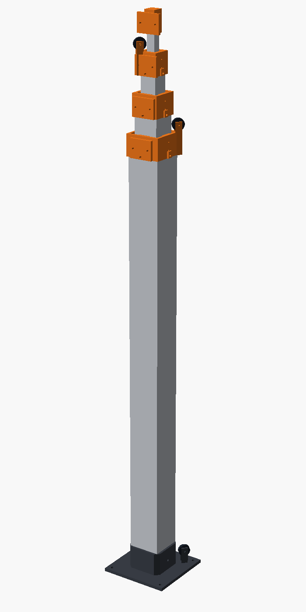
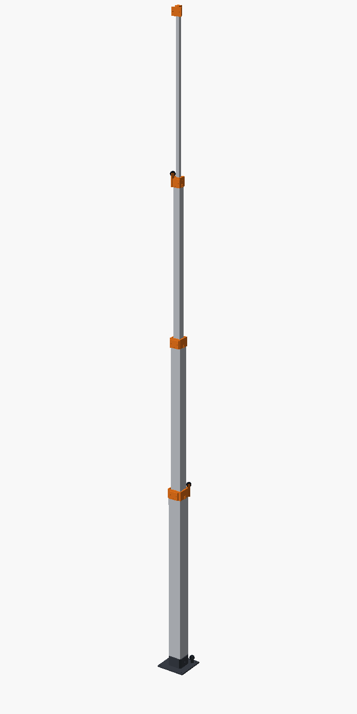

# 3 m teleskopik direk — basılacak parçalar ve montaj

Borular alüminyum kare profil; bu klasör yalnız 3B yazıcıda basılacak bağlantı parçalarını içerir. Tasarım ilkesi ve hesaplar: [`../../docs/TELESKOPIK_DIREK.md`](../../docs/TELESKOPIK_DIREK.md).

 

## Direk

| Boru | Profil | Boy |
|---|---|---|
| 0 (taban) | 60×60×2 | 830 mm |
| 1 | 45×45×2 | 900 mm |
| 2 | 30×30×2 | 900 mm |
| 3 | 15×15×1–2 | 900 mm |

| | Kapalı | Açık (normal sınır, x = 600 mm) |
|---|---|---|
| Direk (taban yuvasının üstünden, en üst kamera) | ~1,05 m | ~2,85 m |
| Kameralar arası | 70 mm | 670 mm |

- **Normal üst sınır** limit anahtarıyla x = 600 mm. Bu noktada borular hâlâ 230 mm iç içe; boru genişliğinin ~5 katı, sağlam.
- **Mekanik acil durdurucu** x ≈ 750 mm'de: ayak pabuçları yaka parmaklarına dayanır.
- Bütün parçalar 0 / 300 / 600 / 750 mm açıklıkta çakışma testinden geçti.

## Baskı listesi

| Dosya | Adet | Not |
|---|---|---|
| `collar0`, `collar1`, `collar2` | 1'er | Yakalar (boruların tepesi) |
| `cap3` | 1 | En içteki borunun kapağı |
| `sleeve1`, `sleeve2`, `sleeve3` | 1'er | Ayak kılıfları (hareketli boruların dibi) |
| `plug1`, `plug2`, `plug3` | 1'er | İç tıpalar; 1 ve 2 aynı zamanda içteki borunun oturduğu yer |
| `pad_2.7` | **24** (+4 yedek) | Kayar pabuç, standart |
| `pad_2.5`, `pad_2.9` | 8'er | Ayar için ince/kalın pabuç |
| `pulley` | 4 | 3 yaka + 1 taban; içine 623ZZ rulman preslenir |
| `base` | 1 | Taban yuvası, robota 4×M5 |
| `drum` | 1 | Motor tamburu (6 mm D mil) |

**Ayarlar (A1, PLA):**
- **Genel:** 0,2 mm katman, 4 duvar, %25 dolgu. Destek gerekmez; dosyalar baskı yönünde hazır.
- **Pabuçlar:** Sırtı tablada, kayan yüzü üstte. Bambu Studio'da **Kalite → Ütüleme (Ironing): "Üst yüzeyler"** açın. Kayan yüz pürüzsüz çıkar; kaymanın iyi olması için en önemli ayar bu.
- **Makara:** Rulman sıkı geçmeli. Gevşekse bir damla yapıştırıcı, girmiyorsa `BRG_D` değerini 0,1 büyütün.

## Hırdavat

| Malzeme | Adet | Nerede |
|---|---|---|
| M3 ısıyla gömülen somun (insert), ~4 mm boy | 40 | Yaka etekleri (12), kamera plakaları (8), tıpalar (12), tambur (1) |
| M3×10 yuvarlak başlı (ISO 7380) cıvata | 30 | Yakalar (12, içeriden), ayaklar (12) |
| M3×16 cıvata + somun | 4 | Makara milleri |
| M3×25 cıvata + somun | 1 | Kapak |
| 623ZZ rulman (3×10×4) | 4 | Makaralar |
| M4×70 cıvata + somun | 1 | Taban yuvası ↔ 60'lık boru |
| M5 cıvata + somun | 4 | Taban yuvası ↔ robot plakası |
| Dyneema 1–1,5 mm | ~8 m | Motor halatı ~3 m, A ve B ~2,5'er m |
| 1,75 mm filament | — | Pabuç pimleri (her pabuç için 2 × ~4 mm) |

## Yön kuralı

Bütün kamera plakaları **öne** baksın. O zaman:

| | Sağ arka | Sol arka | Sol ön |
|---|---|---|---|
| Ayak kulağı (halat bağlanır) | Kılıf 1 | Kılıf 2 | Kılıf 3 |
| Yaka makarası | Yaka 0 | Yaka 1 | Yaka 2 |
| Halat bağlama sütunu | — | Yaka 0 | Yaka 1 |

Taban yuvasındaki yönlendirme makarası **sağ arka** köşededir; motor bu köşegenin dışına konur.

## Delme

Parçalar kendi delme şablonudur.

1. Yakayı borunun tepesine, kılıfı borunun dibine tam oturt.
2. Deliklerden kalemle işaretle, Ø3,4 matkapla del.
3. İçteki ve dıştaki çapağı mutlaka al; içeri taşan her çapak kaymayı bozar.

Delikler yalnız şu bölgelere açılır:
- **Yaka:** Borunun tepesinden **30,5 mm** aşağıda, her yüzde 1 delik.
- **Kılıf:** Borunun dibinden **8 mm** yukarıda, her yüzde 1 delik.
- **Taban borusu (60'lık):** Dibinden **19 mm** yukarıda, karşılıklı iki yüzden geçen Ø4,4 delik.

Borunun kayan bölgesine (bunlar dışında hiçbir yere) delik açılmaz.

## Montaj (içten dışa; içteki boru dıştakine **alttan** girer)

> Yakadaki ve ayaktaki pabuçlar birbirini geçemez; bu yüzden her boru, dıştakinin yakası takılı, **ayağı henüz takılmamışken alttan** sokulur.

1. **Hazırlık:**
   - Isıl somunları havya ile yerine bas.
   - Rulmanları makaralara presle.
   - Pabuçları filament pimlerle yaka parmaklarına (içe bakar) ve kılıflara (dışa bakar) tak. Başlangıçta hepsi `pad_2.7` olsun.
2. **Boru 3:**
   - Kılıf 3 + tıpa 3'ü dibine bağla (cıvatalar kılıftan → boru → tıpadaki somuna).
   - Kılıf 3'ün sol ön kulağına **B halatını** bağla.
   - Kapak 3'ü tepeye tak.
3. **Boru 2:**
   - Yaka 2'yi tepeye tak; cıvatalar borunun **içinden** dışa, etekteki somunlara.
   - Boru 3'ü boru 2'nin **altından** sok; B halatı sol ön köşeden yukarı çıksın.
   - Sonra kılıf 2 + tıpa 2'yi boru 2'nin dibine bağla, **A halatını** kılıf 2'nin sol arka kulağına bağla.
4. **Boru 1:** Yaka 1 → boru 2'yi alttan sok → kılıf 1 + tıpa 1 → **motor halatı** kılıf 1'in sağ arka kulağına.
5. **Boru 0:** Yaka 0 → boru 1'i alttan sok → boru 0'ı taban yuvasına otur, M4 cıvatayla sabitle.
6. **Makaralar:** Yakalardaki ve tabandaki kulaklara M3×16 ile takılır.
7. **Halatlar:** Bütün borular kapalı ve yerlerinde dururken bağlanır: boru 1 tabanda, boru 2 tıpa 1'in, boru 3 tıpa 2'nin üstünde. Gergin olsunlar ama çekmesinler.
   - **B:** Kılıf 3 → yaka 2 makarası → yaka 1'in sol ön bağlama sütunu.
   - **A:** Kılıf 2 → yaka 1 makarası → yaka 0'ın sol arka bağlama sütunu.
   - **Motor halatı:** Kılıf 1 → yaka 0 makarası → boru 0'ın dışından aşağı → taban makarası → motor tamburu.

## Kayma ayarı

| Durum | Ne yapılır |
|---|---|
| Takılıyor / sıkı | O yüzdeki pabucu `pad_2.5` ile değiştir |
| Yana oynuyor | `pad_2.9` ile değiştir |
| Hâlâ sürtünme fazla | Pabuçlara kuru PTFE/silikon sprey; gres değil |
| Pabuçlar aşınıyor | Aynı ölçüde POM (Delrin) levhadan kes |

Her yüzü ayrı ayarlayabilirsin; alüminyum profiller tam düzgün olmayabilir.

## Yeniden üretim

Ölçüler `direk_3m.scad` başındadır. Boru ölçüsü, boşluk vb. değiştirince:

```bash
./build.sh
```
