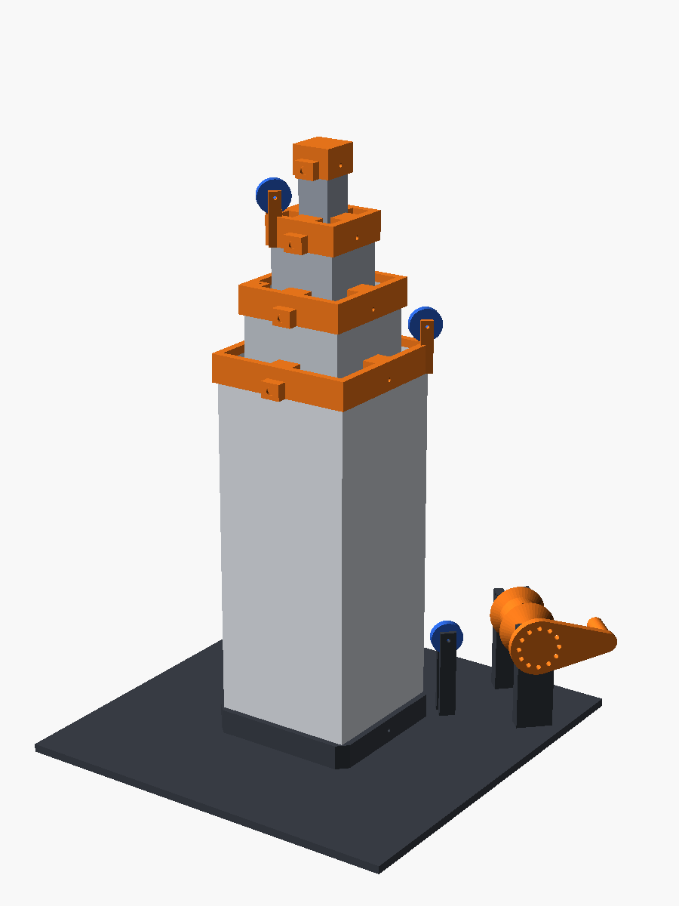
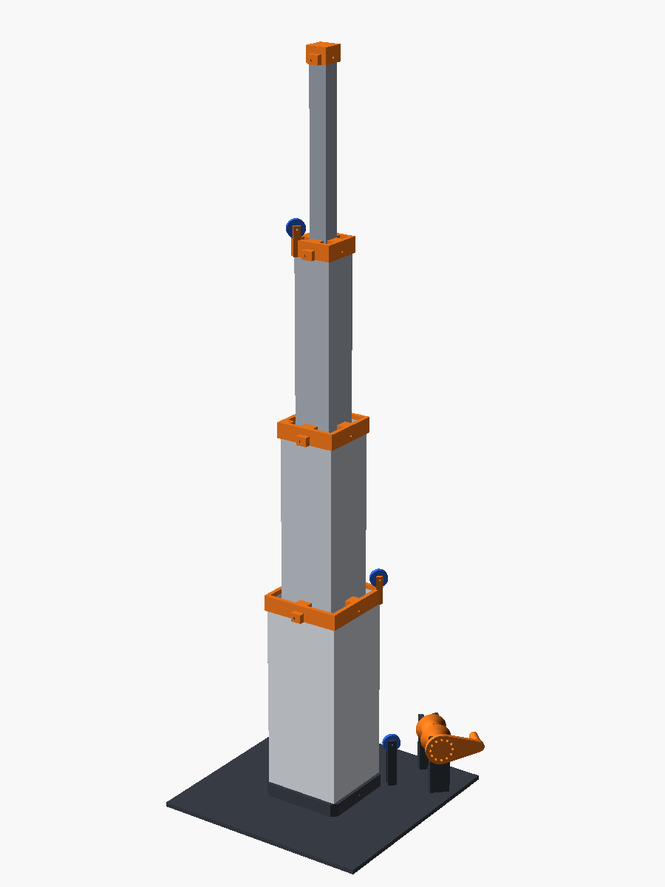

# Mini teleskopik direk (masa üstü, tamamı PLA)

Dört iç içe boru, üç halat, elle çevrilen vinç. Vinç 1. boruyu `x` kaldırınca 2. boru `2x`, 3. boru `3x` yükselir; boruların tepeleri (kamera yerleri) arasındaki mesafe hep eşittir. Amaç gerçek prototipten önce şunları ucuza denemek: 1:2:3 oranı, pabuç boşluğu, halat yolu, durdurucu.

 

| | Kapalı | Açık (x = 125 mm) |
|---|---|---|
| En üst kamera (tabandan) | ~29 cm | ~67 cm |
| Kameralar arası | 32 mm | 157 mm |

Durdurucu x ≈ 132 mm'de devreye girer (alt pabuçlar üst pabuçlara dayanır). Bütün parçalar 0, 60, 125 ve 132 mm açıklıkta çakışma testinden geçti.

## Baskı (Bambu Lab A1, tek renk PLA)

`stl/` klasöründeki dosyalar baskı yönünde hazır; döndürmeyin. **Destek gerekmez.**

| Dosya | Adet | Not |
|---|---|---|
| `tube0.stl` … `tube3.stl` | 1'er | Uzun ince parça: **kenar (brim) 5 mm** açın; `tube3` için hızı biraz düşürün |
| `collar0.stl`, `collar1.stl`, `collar2.stl` | 1'er | Yakalar: üst pabuç + makara kulağı + halat bağlama |
| `cap3.stl` | 1 | En içteki borunun kapağı |
| `pulley.stl` | **4** | 3 yaka + 1 tabandaki yönlendirme |
| `stand.stl` | 1 | 200×200 mm taban; dolgu %15 yeter |
| `drum.stl` | 1 | Vinç: krank + mil + tambur, tek parça |

Ayarlar: 0,2 mm katman, 0,4 nozul, duvar 4–5 tur (borular 2 mm et), dolgu %15. Toplam ~600 g PLA, kabaca 12–16 saat.

**Dışarıdan:** ~3 m örgü misina (0,4–0,5 mm, ≥20 kg) veya sağlam ip; **1,75 mm filament parçaları** makara mili ve sabitleme pimi olarak kullanılır (aynı makaradan kesilir).

## Yön kuralı

Bütün yakalardaki küçük **kamera çıkıntısı öne (kendine) baksın**. O zaman:

| Parça | Sağ arka | Sol arka | Sol ön |
|---|---|---|---|
| Ayak kulağı (halat bağlanır) | Boru 1 | Boru 2 | Boru 3 |
| Yaka makarası | Yaka 0 | Yaka 1 | Yaka 2 |
| Yaka halat bağlama sütunu | — | Yaka 0 | Yaka 1 |

Tabandaki yönlendirme makarası ve vinç **sağ arka** köşededir.

## Montaj (içten dışa)

> Halatları ayak kulaklarına **boruyu bir dıştakine sokmadan önce** bağlayın; sonra kulağa ulaşılamaz.

1. **Halatları bağla:** Boru 3'ün ayak kulağına (sol ön) B halatını, boru 2'ninkine (sol arka) A halatını, boru 1'inkine (sağ arka) motor halatını düğümle. Her birine ~1 m bırak.
2. **Boru 3 → boru 2:** Boru 3'ü boru 2'nin **üstünden** ayak tarafıyla sok; B halatının ucu boru 2'nin ağzından dışarıda kalsın. Kuru deneme: rahat kayıyor ama yana oynamıyor mu? (Bkz. Ayar.)
3. **Yaka 2'yi tak:** Boru 2'nin tepesine geçir, iki yandaki deliklerden 1,75 filament pim it (yaklaşık 10 mm, dışta kalan kısmı kes). Kapak 3'ü boru 3'e aynı şekilde tak.
4. **Boru 2 → boru 1,** sonra **yaka 1**. **Boru 1 → boru 0,** sonra **yaka 0**.
5. **Taban:** Boru 0'ı tabandaki sokete otur, pimle. Boru 1 tablaya, boru 2 ve 3 ortadaki basamaklı kaideye oturur.
6. **Makaralar:** Her makarayı kulakların arasına koyup içinden 1,75 filament mil geçir, iki yandan taşan kısmı kes.
7. **Halat yolu:**
   - **B:** boru 3 ayağından yukarı → yaka 2 makarası (içten çıkar, üstünden dolan, dıştan iner) → yaka 1'in sol ön bağlama sütunundaki delikten geçir, altında düğümle.
   - **A:** boru 2 ayağından yukarı → yaka 1 makarası → yaka 0'ın sol arka bağlama sütunu.
   - **Motor:** boru 1 ayağından yukarı → yaka 0 makarası → boru 0'ın dışından aşağı → yönlendirme makarasının iç tarafından inip altından dolan → tambur; tamburdaki delikten geçirip düğümle.
   - Halatları bütün borular kapalı (dinlenme yerlerinde) iken **gergin ama çekmeden** bağla.
8. **Vinç:** Tamburu U yataklara otur, yatakların üstündeki deliklerden filament pim geçirerek mili hapset.
9. **Kilit:** İstediğin yükseklikte iç yataktaki delikten krank göbeğindeki deliklerden birine bir pim (filament ya da çivi) sok.

## Test listesi

1. Krankı 10 mm halat saracak kadar çevir: boru 1 ~10, boru 2 ~20, boru 3 ~30 mm yükseliyor mu?
2. Tam açıp kapat (10 kez): takılma, halat kayması, makaranın düşmesi var mı?
3. Tam açıkken tepeyi hafifçe it: ne kadar sallanıyor?
4. Kilidi tak, krankı bırak: direk yerinde kalıyor mu?

## Ayar ve yeniden üretim

Ölçüler `mini_direk.scad` başındaki değişkenlerdedir. Değiştirdikten sonra:

```bash
./build.sh
```

| Sorun | Değişken |
|---|---|
| Borular sıkı, takılıyor | `C` büyüt (0,4 → 0,5); boru ve yakaları yeniden bas |
| Tepe çok sallanıyor | `C` küçült (0,4 → 0,3) veya `FOOT_H` büyüt |
| Yaka boruya gevşek/sıkı | `FIT` (0,2) |
| Makara mili gevşek | `AXLE_D` (1,8) |

Montaj görünümünü başka bir açıklıkta görmek için: `openscad -D 'part="assembly"' -D x=80 mini_direk.scad`.
